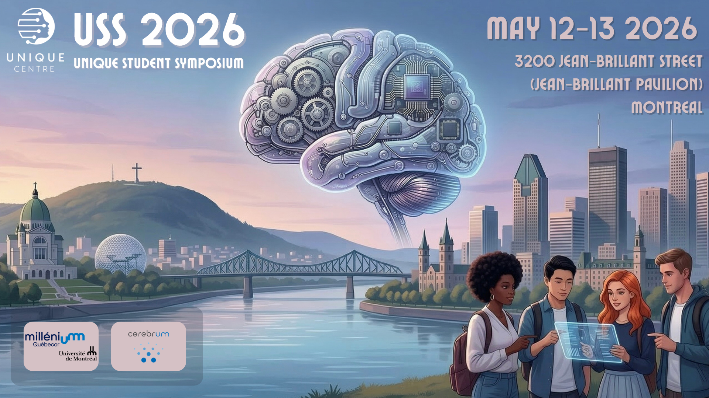

[UNIQUE (Unifying Neuroscience and Artificial Intelligence in Québec)](https://sites.google.com/view/unique-neuro-ai) is a research centre working at the intersection of neuroscience and artificial intelligence research. It consists of more than 80 researchers affiliated with several universities and research centres from different regions of the province, and even from outside of it. The main goal of UNIQUE is to promote and facilitate exchanges between research teams working at the intersection of artificial intelligence (AI) and neuroscience.

---

# Upcoming Event: UNIQUE Fellows Get-Together - Fall 2026

  

    

      

        
UNIQUE Fellows Get-Together Fall 2026: November 25 at Université de Montréal

      

    

    

      Share your work with the broader UNIQUE community! We invite UNIQUE students to showcase their Neuro-AI projects, including preliminary or anticipated results, and warmly invite UNIQUE scholarship recipients to sign up to give a short talk. This edition is <strong>hybrid</strong>: present and join in person or online. Pizza will be served for those attending in person!
        
      <b>Date & Time:</b> Wednesday, 25 November 2026, from 5 pm to 7 pm EST (a <em>5 à 7</em>, with an informal social afterward) 
      <b>Venue:</b> <a href="https://maps.app.goo.gl/N9B9a3PCz4mH2iXJ7">Room G-445, Pavillon Marie-Victorin, Université de Montréal</a> (or online) 
      <b>Talk format:</b> 5 minutes talk + 5 minutes Q&A 
      <b>Prize:</b> $200 for the best presentation! 🏆 
      <b>Sign up:</b> <a href="https://docs.google.com/forms/d/e/1FAIpQLSc1BkR_uKJf0Pz6pUNCYt7gV3ofUwiVR3qu7SlVRmXStmjm2Q/viewform?usp=header">Google form</a> by <b>Friday, 20 November</b>, to attend or to present.
        
      The schedule will be announced soon. <a href="/2026/get-together-fall">Event page</a>.
    

  

---

# Thanks for attending USS 2026!

<ul class="inlinelist" style="margin-top: 2em;"><li class="inlinelist"><a href="/2026/schedule.html"><button class="button is-primary">Schedule</button></a></li>  <li class="inlinelist"><a href="/2026/speakers.html"><button class="button is-primary">Speakers</button></a></li>  <li class="inlinelist"><a href="/2026/poster.html"><button class="button is-primary">Poster Contest</button></a></li>  <li class="inlinelist"><a href="/2026/team.html"><button class="button is-primary">USS Team</button></a></li></ul>

 

  

    <figure class="image">
      
    </figure>
  

  

    

      

        
UNIQUE Student Symposium 2026: May 12-13 at Université de Montréal

      

    

    

      The UNIQUE Student Symposium (USS) 2026 took place on 12-13 May at the Jean-Brillant Pavilion, <a href="https://www.umontreal.ca/en/">Université de Montréal</a>, in Montréal. Thank you to everyone who attended!
        
      USS is a student-oriented, student-organized conference at the crossroads of neuroscience and AI research. The goal is to provide students in those fields with an event tailor made to their needs and presenting the state of the art of what is done in neuro-AI research.

      <h3>Event Details</h3>
      <b>Day 1: Tuesday, 12 May 2026</b> 
      <b>Day 2: Wednesday, 13 May 2026</b> 
      <b>Location: <a href="https://maps.app.goo.gl/">Jean-Brillant Pavilion, Université de Montréal, 3200 Jean-Brillant Street</a></b> 
      <b>See the schedule <a href="/2026/schedule.html">here</a>.</b> 
      <b>See the speakers <a href="/2026/speakers.html">here</a>.</b>

      <!-- <h3>Important Information</h3>
      <b>Registration: <a href="https://www.eventbrite.ca/e/unique-student-symposium-2026-tickets-1987516837363">click here!</a></b>
        
      <b>Poster submission & volunteer recruitment: <a href="https://forms.gle/Lr97HxzwZPqMP9WKA">click here!</a></b>
       
      <b>Deadline:</b> 29 April 2026
        
      Note: The event is open to all people working in Neuro-AI (UNIQUE member or not). -->

      <h3>Accessibility and Code of Conduct</h3>
      We strive to create an accessible and inclusive event. Please be informed that:
      <ul>
      <li>All participants are required to follow the <a href="/coc.html">Code of Conduct</a>.</li>
      <li>If you have any accessibility needs that you would like us to know, please contact us at <code>{{ site.email }}</code>.</li>
      </ul>

      

      <figure class="image">
        
      </figure>
       
      Le Symposium Étudiant UNIQUE (USS 2026) s'est déroulé du 12 au 13 mai 2026 au Pavillon Jean-Brillant, <a href="https://www.umontreal.ca/">Université de Montréal</a>, à Montréal. Merci à toutes et à tous d'y avoir participé!
        
      <b>Date :</b> Mardi 12 mai et Mercredi 13 mai 2026 
      <b>Lieu :</b> <a href="https://maps.app.goo.gl/">Pavillon Jean-Brillant, Université de Montréal, 3200 rue Jean-Brillant</a>
      <!--   
      <b>Inscription : <a href="https://www.eventbrite.ca/e/unique-student-symposium-2026-tickets-1987516837363">formulaire</a></b>
        
      <b>Présentations d'affiche et recrutement de bénévoles : <a href="https://forms.gle/Lr97HxzwZPqMP9WKA">formulaire</a></b>
       
      <b>Date limite :</b> 29 avril 2026
        
      Note: l'événement est ouvert à toutes les personnes travaillant dans le domaine de la Neuro-AI (membres d'UNIQUE ou non). -->
    

  

# Never miss any of our events!

Do you want to be informed about all UNIQUE Neuro-AI events, activities, and opportunities?
 
Subscribe to our [Mailing List](https://docs.google.com/forms/d/e/1FAIpQLSc4zY0T3-Y0XRSt4JbWza8eEUjqH9SVERaXyZwzOrcvEdp2bA/viewform) or follow us on [Twitter](https://twitter.com/ai_unique)!

## Contact

If you have questions, feedback or just want to say hi, please send us an email to `{{ site.email }}`.
